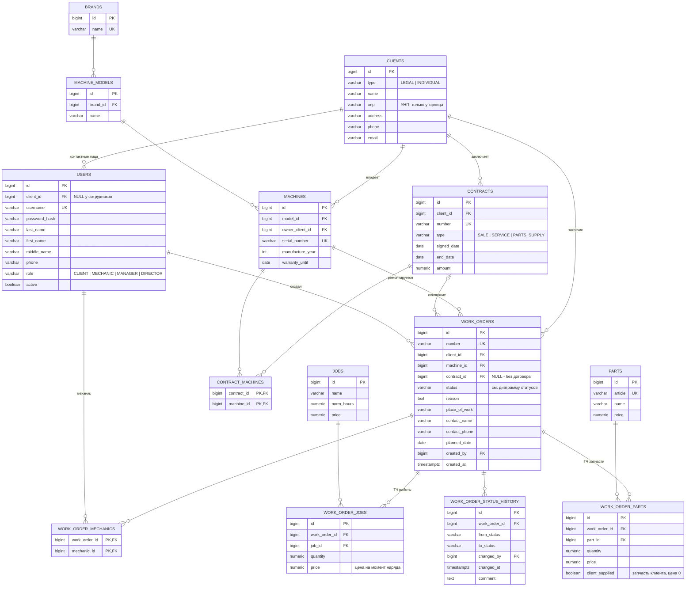
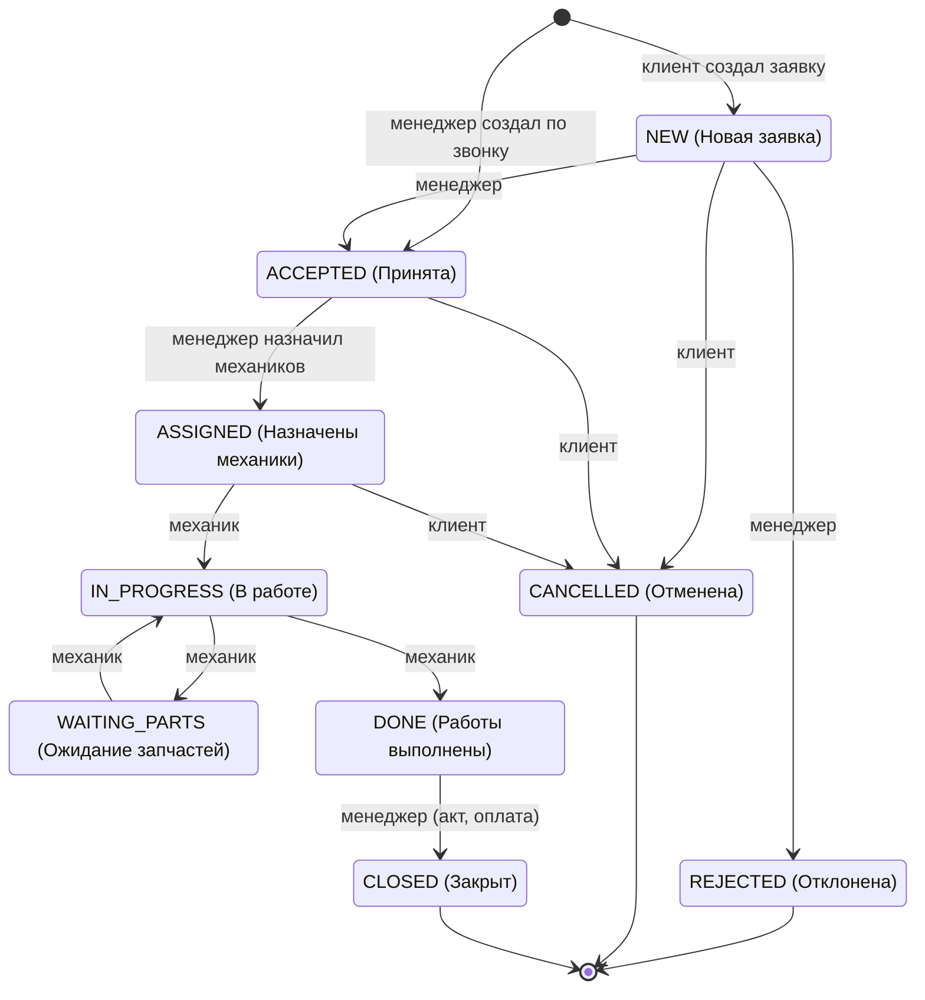

# ER-модель AgroTechCare

Версия 1 — модель данных для этапов 1–3 roadmap: клиенты, техника, договоры, заказ-наряды.
Технические таблицы интеграции с 1С (outbox/inbox) появятся на этапе 4 и здесь не описаны.

## Диаграмма

## Сущности

| Таблица | Назначение | Аналог в 1С |
|---|---|---|
| `clients` | Контрагент — юрлицо или физлицо, сторона договора | Справочник «Контрагенты» |
| `users` | Учётная запись: клиент, механик, менеджер, директор | Справочник «Пользователи» |
| `brands` | Производитель техники (МТЗ, John Deere) | Справочник «Производители» |
| `machine_models` | Модель техники (Беларус 82.1) | Справочник «Номенклатура» |
| `machines` | Конкретная машина с серийным номером | Серия номенклатуры |
| `contracts` | Договор продажи, сервиса или поставки запчастей | Справочник «Договоры контрагентов» |
| `contract_machines` | Какие машины входят в договор | Табличная часть договора |
| `work_orders` | Заказ-наряд на ремонт | Документ |
| `work_order_mechanics` | Механики, назначенные на заказ-наряд | Табличная часть документа |
| `work_order_status_history` | История смены статусов | Регистр сведений |
| `jobs` | Справочник работ с нормочасами и ценой | Справочник «Работы» |
| `work_order_jobs` | Работы в заказ-наряде | Табличная часть «Работы» |
| `parts` | Справочник запчастей | Справочник «Номенклатура» |
| `work_order_parts` | Запчасти в заказ-наряде | Табличная часть «Запчасти» |

## Перечисления

**`clients.type`**
- `LEGAL` (юридическое лицо)
- `INDIVIDUAL` (физическое лицо)

**`users.role`**
- `CLIENT` (клиент)
- `MECHANIC` (механик)
- `MANAGER` (менеджер)
- `DIRECTOR` (директор)

**`contracts.type`**
- `SALE` (купля-продажа)
- `SERVICE` (сервисное обслуживание)
- `PARTS_SUPPLY` (поставка запчастей)

## Статусы заказ-наряда

Каждый переход записывается в `work_order_status_history`.
Согласование сметы клиентом добавится отдельным статусом на этапе 3.

## Проектные решения

- **Клиент и пользователь разделены.** `clients` — сторона договора (юрлицо или физлицо), `users` — тот, кто входит в приложение. Сотрудники компании — пользователи без `client_id`.
- **Связи «один ко многим» — внешний ключ, без таблицы-связки.** Например, `contracts.client_id`. Отдельные таблицы только для «многие ко многим»: `contract_machines`, `work_order_mechanics`.
- **Владелец машины — клиент, а не пользователь** (`machines.owner_client_id`): все сотрудники клиента видят его технику.
- **Договор и машины — «многие ко многим».** В одном договоре может быть несколько машин, а одна машина может быть сначала в договоре продажи, потом в сервисном.
- **Заказ-наряд явно ссылается на договор-основание.** Через машину его не определить, ведь у машины может быть несколько договоров. `NULL` означает разовый ремонт без договора. Если договор указан, машина должна в нём быть (проверяется в коде).
- **`work_orders.client_id` — снимок на момент создания.** Владелец машины может смениться, а наряд остаётся за заказчиком.
- **Цена копируется в строку наряда.** Изменение цены в справочнике не меняет старые наряды.
- **Итоговая сумма наряда не хранится** — считается по табличным частям.
- **Деньги — `numeric`** (в Java `BigDecimal`), пароль хранится только в виде хеша.
- **Таблицы во множественном числе, сущности в единственном**: таблица `users` — класс `User`, `work_orders` — `WorkOrder`, связь через `@Table(name = "...")`. Заодно обходим `user` — зарезервированное слово в PostgreSQL. Исключение — `work_order_status_history`: «history» неисчисляемое.
